<div align="center">


# Lumen

**A modern, fast and safe admin panel for OpenWrt.**

Live dashboards, a network map, per-device traffic, Wi-Fi, firewall and software management,
in one lightweight web app that installs with a single command.

<br>


[Features](#features) · [Screenshots](#screenshots) · [Install](#installation) · [How it works](#how-it-works) · [Security](#security-model) · [FAQ](#faq)

<br>

<picture>
  <source media="(prefers-color-scheme: light)" srcset="docs/screenshots/dashboard-light.png">
  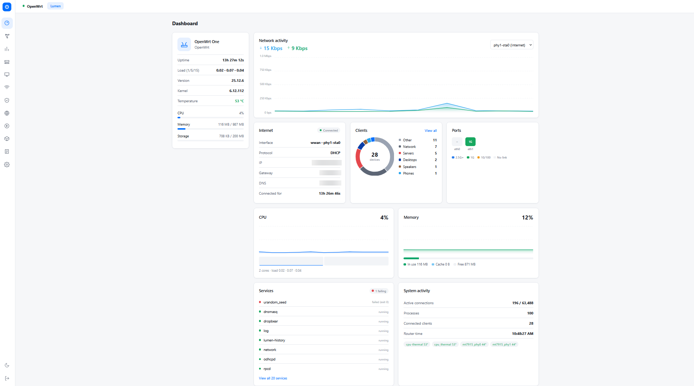
</picture>

<picture>
  <source media="(prefers-color-scheme: dark)" srcset="docs/screenshots/dashboard-dark.png">
  
</picture>

</div>

<br>

## Why Lumen

OpenWrt is superb firmware, but its default interface is built for configuring, not for *seeing* your network.
Lumen puts a modern console on top of it: a compact icon rail, cards, live charts and slide-over detail panels,
in light and dark themes, on desktop and phone.

- **See everything at a glance.** Throughput, CPU, memory, temperatures, services, ports and every device on the network, live.
- **Know who uses what.** Traffic history per interface and per device, with names, vendors and logos.
- **Change things without fear.** Every risky change has a countdown and rolls back by itself if you lose access.
- **Light on the router.** A ~115 KB web app and two tiny components. No database, no Node.js, nothing running in the background except a small collector.
- **Lives next to LuCI.** It never touches LuCI, so you always have a fallback.
- **Installs and updates itself.** One command to install, one click to update, one click to remove.

<br>

## Features

### At a glance
- **Dashboard** with live network activity, CPU, memory and storage, temperatures, Internet status, ports and their speeds, clients by type, running services and system activity (connections, processes).
- **Light and dark** themes, responsive layout, and a single batched request every two seconds feeding every page.

### Network map
- A router-centred diagram: **Internet → router → ports and SSIDs → devices**, wired links solid and Wi-Fi links dashed, with signal strength per device.
- Every device shows its **name, IP and MAC** (or IP and MAC when it has no name). Click any node for details.

### Traffic
- **History** for 1 hour, 24 hours, 7, 30 and 90 days, per interface, with peaks, averages and totals.
- **Per-device usage** (download and upload) for the last 24 hours, 7 or 30 days, with a chart for each device, and a **Top clients** card on the dashboard.

### Devices
- A **client list** with connection (port or SSID), signal, last-24h usage and DHCP lease, searchable and sortable.
- **Vendor recognition** from the MAC address (about 54 000 vendors), **brand logos** for the popular ones, and a clear "Private address" label for phones that randomise their MAC.
- **Give any device a name and a type** by hand. They are stored on the router, tied to the MAC, and show up everywhere.

### Wi-Fi
- Radios (channel, width, country, power), SSIDs with WPA3, WPA2/WPA3, WPA2, OWE or open, hidden networks, client isolation, a passphrase generator, and connected clients with a **Disconnect** button.

### Firewall
- **Port forwards** with a client picker, **traffic rules** you can reorder (first match wins), **zones** with default policies and forwardings.

### DHCP & DNS
- DHCP pools per interface, upstream DNS, rebinding protection, and **static IP reservations** (add them straight from a known client).

### Software
- Browse **installed packages and available updates**, search the repositories (about 11 000 packages), and install, remove or upgrade, always with a **preview of exactly what will change** and a live log.
- Checks whether a **newer OpenWrt release** exists for your router.

### System
- **Services** with running / failed state, **logs**, hardware details, temperatures, reboot, and **Lumen's own update and uninstall**.

<br>

## Screenshots

<table>
  <tr>
    <td width="50%"><a href="docs/screenshots/dashboard-light.png"></a><br><b>Dashboard</b><br><sub>Live overview: throughput, CPU, memory, ports, clients and services.</sub></td>
    <td width="50%"><a href="docs/screenshots/network-map.png">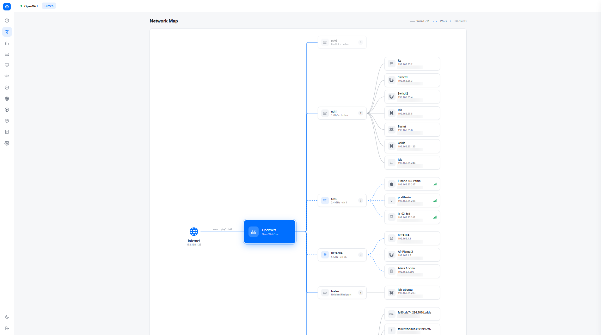</a><br><b>Network map</b><br><sub>Internet, router, ports, SSIDs and every device, with Wi-Fi signal.</sub></td>
  </tr>
  <tr>
    <td width="50%"><a href="docs/screenshots/traffic.png">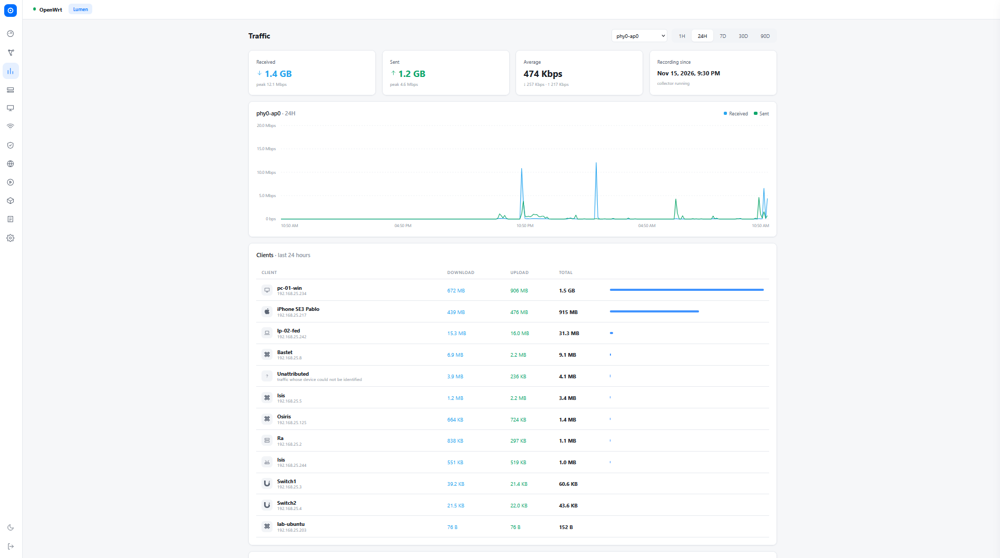</a><br><b>Traffic</b><br><sub>History per interface and a breakdown by device.</sub></td>
    <td width="50%"><a href="docs/screenshots/network.png">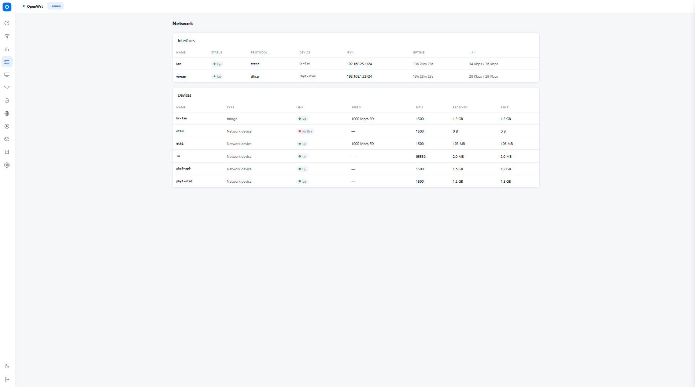</a><br><b>Network</b><br><sub>Interfaces and devices with live rates.</sub></td>
  </tr>
  <tr>
    <td width="50%"><a href="docs/screenshots/clients.png">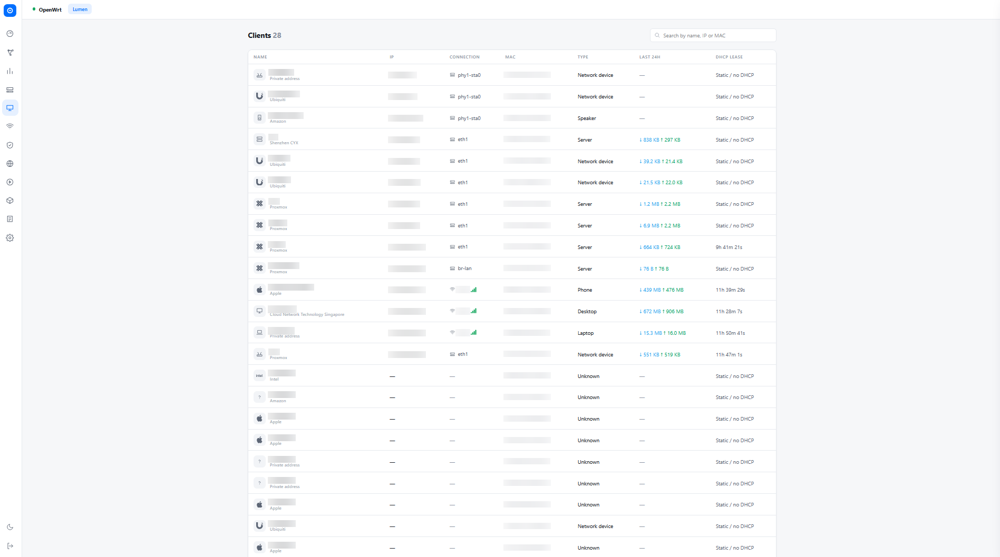</a><br><b>Clients</b><br><sub>Vendor, type, connection, signal and last-24h usage for every device.</sub></td>
    <td width="50%"><a href="docs/screenshots/wifi.png">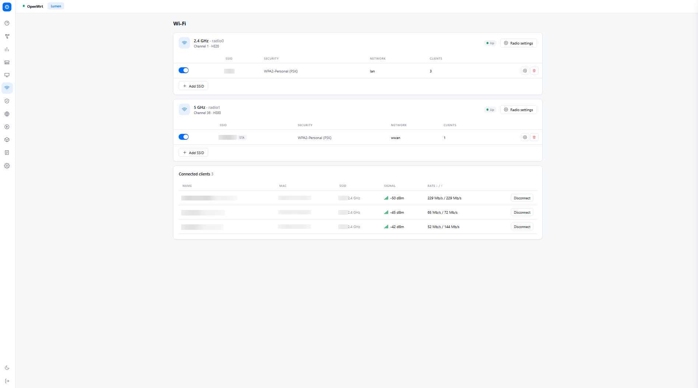</a><br><b>Wi-Fi</b><br><sub>Radios, SSIDs and connected clients.</sub></td>
  </tr>
  <tr>
    <td width="50%"><a href="docs/screenshots/firewall.png">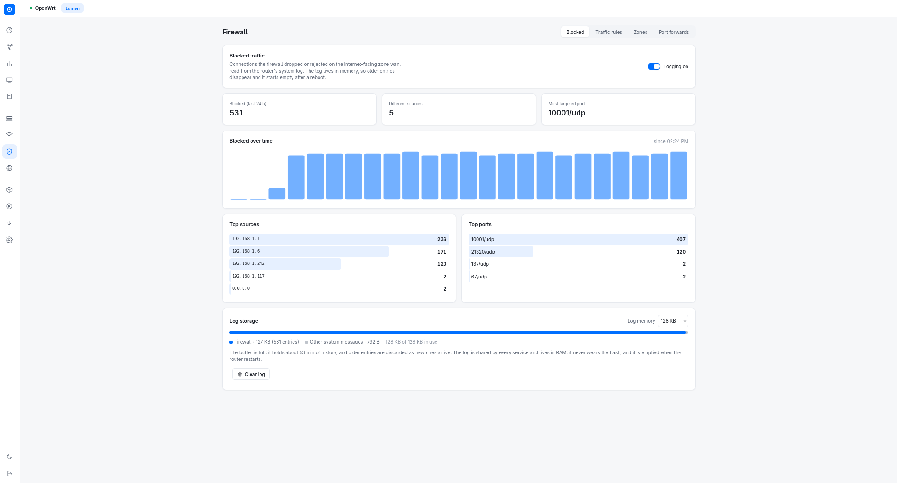</a><br><b>Firewall</b><br><sub>Reorderable traffic rules, port forwards and zones.</sub></td>
    <td width="50%"><a href="docs/screenshots/dhcp-dns.png">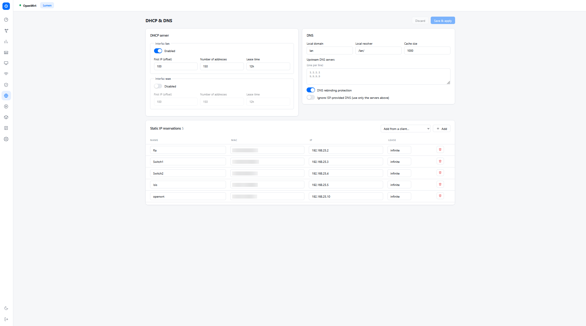</a><br><b>DHCP &amp; DNS</b><br><sub>DHCP pools, upstream DNS and static reservations.</sub></td>
  </tr>
  <tr>
    <td width="50%"><a href="docs/screenshots/services.png">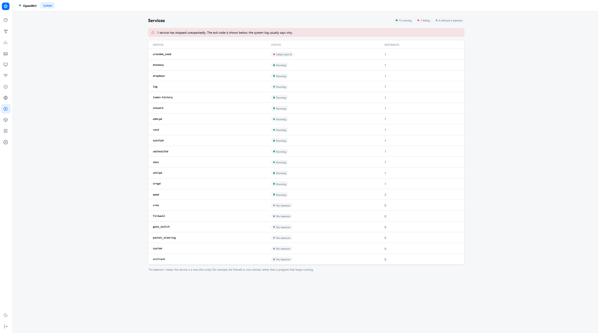</a><br><b>Services</b><br><sub>Health of every service at a glance.</sub></td>
    <td width="50%"><a href="docs/screenshots/software.png">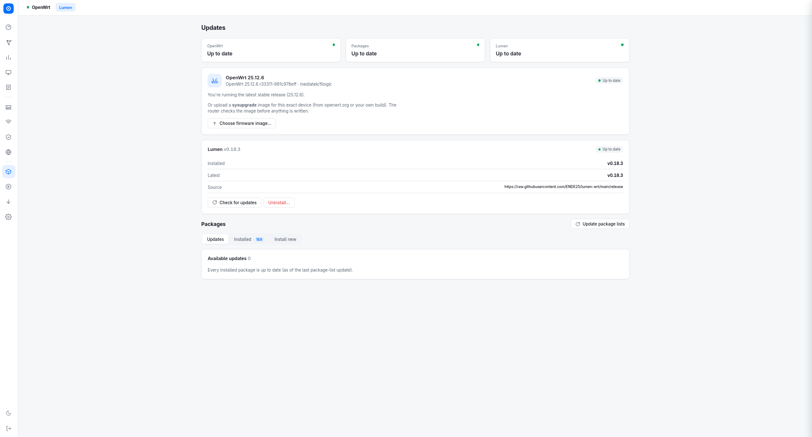</a><br><b>Software</b><br><sub>Firmware release check and package updates.</sub></td>
  </tr>
  <tr>
    <td width="50%"><a href="docs/screenshots/logs.png">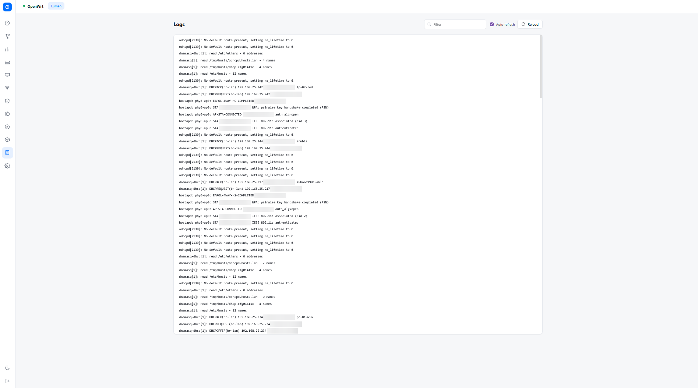</a><br><b>Logs</b><br><sub>The system log with a live filter.</sub></td>
    <td width="50%"><a href="docs/screenshots/system.png">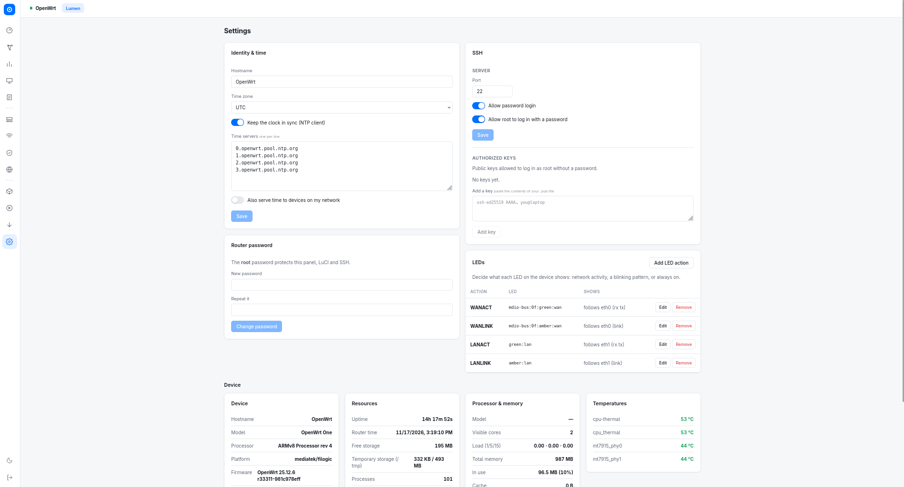</a><br><b>System</b><br><sub>Hardware, temperatures, power, and Lumen's own update and uninstall.</sub></td>
  </tr>
</table>

<sub>Screenshots are taken on a real OpenWrt One. Device names, addresses and MACs are blurred.</sub>

<br>

## Installation

### Requirements

- A router running **OpenWrt**, **tested on 25.12** (it runs on the OpenWrt One and on x86). It is architecture-independent: it only needs `ubus`, `rpcd`, `uhttpd` (with its ubus endpoint, on by default), `usign` and `jsonfilter`, all part of a standard image.
- **LuCI's base packages** (`luci-base` and the usual apps). Lumen reads hosts, leases and wireless status through `rpcd-mod-luci` and relies on the access rules LuCI installs. Default images include them. Lumen runs alongside LuCI and never modifies it.
- **Root SSH** access, and **working DNS and HTTPS from the router** (it downloads the release itself).
- About 4 MB free in `/usr` and `/www`.

### Install

1. SSH into the router. Optionally check that it can reach the release server:

   ```sh
   uclient-fetch -qO- https://raw.githubusercontent.com/ENDE25/lumen-wrt/main/release/latest.json
   ```

   It should print a small JSON with the latest `"version"`.

2. Run the installer:

   ```sh
   wget -qO- https://raw.githubusercontent.com/ENDE25/lumen-wrt/main/release/install.sh | sh
   ```

   It downloads the latest release, checks its **SHA-256** and its **Ed25519 signature** (with OpenWrt's own `usign`),
   installs, starts the collector, checks that everything came up, and prints the address. If any step fails it stops
   or rolls back without leaving a half-installed panel.

3. Open `http://<router-ip>/lumen/` and sign in with the router's **root** user and password.

**What gets installed** (recorded in `/usr/share/lumen/files.list`; nothing else is ever written):

| Path | What |
|---|---|
| `/www/lumen/` | the web panel |
| `/usr/share/rpcd/ucode/lumen`, `/usr/share/rpcd/acl.d/lumen.json` | rpcd plugin and its permissions |
| `/usr/libexec/lumen/` | traffic collector, package job runner, the manager (`lumen`) |
| `/etc/init.d/lumen-history` | collector service (enabled at boot) |
| `/etc/config/lumen` | your settings (created once, never overwritten) |
| `/usr/bin/lumen` | symlink to the manager |

### Update

- **From the panel:** *System → Lumen*. A blue **Update available** badge appears in the top bar when a newer version
  is published. Press **Update**; you will be asked to sign in again (rpcd restarts).
- **From SSH:** `lumen update` (add `--force` to reinstall the current version).
- Before changing anything the manager backs up the installed files. If the new version does not pass its health
  check it is **rolled back automatically**. Updates are only accepted when signed with the key pinned at install time.
- `lumen check` and `lumen status` tell you what is installed and whether something newer exists.

### Uninstall

- **From the panel:** *System → Lumen → Uninstall…*. Tick *Also delete my settings* to wipe them too.
- **From SSH:** `lumen uninstall`, or `lumen uninstall --purge` to also delete `/etc/config/lumen`.

This removes the panel, the rpcd plugin, the collector service, its nftables table and the manager itself. By default
your settings (device names and types, collector options) stay in `/etc/config/lumen` and come back if you reinstall.
LuCI and the rest of OpenWrt are never touched.

### Troubleshooting

| Symptom | Likely cause / fix |
|---|---|
| `could not download …/latest.json` | The router has no Internet or DNS. Try `nslookup raw.githubusercontent.com`; on a default image `dnsmasq` must be running. |
| `checksum mismatch` | The download was corrupt or tampered with. Nothing was changed; try again. |
| `signature check failed` | The release is not signed by the Lumen key pinned on this router. Nothing was changed. |
| `usign is required` | `usign` is missing (it normally ships with OpenWrt). Install it with `apk add usign` or `opkg install usign`. |
| `not enough free space` | Free about 4 MB on `/usr`. |
| Clients, Wi-Fi or DHCP pages show "Object not found" / "Access denied" | LuCI's base packages are missing (`apk add luci-base` or `opkg install luci-base`). |
| Login fails or the page is blank | Check `ubus call lumen stats` and `uci get uhttpd.main.ubus_prefix` (should be `/ubus`); `/etc/init.d/rpcd restart` often helps. |
| Traffic → Clients is empty | Per-client accounting counts traffic *routed through* the router, and under-counts with flow offloading. |
| Software cannot download packages | The router needs working DNS to reach the package repositories. |
| Use a different release source | `uci set lumen.update.url=https://…/release && uci commit lumen` |

<br>

## How it works

Lumen has **no server of its own**. The router's own web server serves a static web app, and that app talks
to the router over the same JSON-RPC channel LuCI uses. Two small components on the router fill the gaps that
stock OpenWrt leaves.

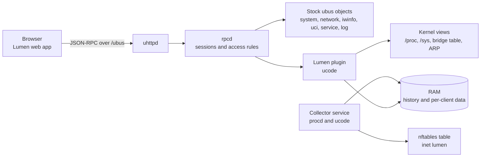

### The pieces

| Piece | What it is | What it does |
|---|---|---|
| **Web app** | Static SPA (Svelte 5, TypeScript, no runtime dependencies), served from `/www/lumen` | All the screens. Logs in through rpcd, polls one batched request every two seconds, keeps only a ring buffer of recent samples in the browser. |
| **rpcd plugin** | A ucode script loaded by rpcd | Adds what stock ubus lacks: container-correct host stats, which bridge port or SSID each client sits behind, the traffic history, package management and Lumen's own update. |
| **Collector** | A small procd service written in ucode | Samples interface counters, maintains the per-client nftables counters and writes both to RAM. |
| **Manager** | One shell script, `lumen` | Installs, updates, rolls back and uninstalls Lumen. |

### Live data
The dashboard asks for system info, interface status and device statistics in **one HTTP request** every two
seconds, and turns the byte counters into rates in the browser. Network, hosts, leases, Wi-Fi associations and
the bridge table are combined into a single view of "who is connected where", which the Clients list and the
Network Map share.

### Safe configuration changes
Anything that edits configuration goes through OpenWrt's own `uci apply` with a **rollback timer**:

1. Lumen stages the change and applies it with a 30-second countdown.
2. For low-risk areas (DHCP and DNS) it confirms automatically once the router still answers.
3. For anything that could lock you out (firewall, Wi-Fi) the confirm bar stays on screen until **you** press *Confirm*.
4. If nobody confirms, or the router becomes unreachable, **rpcd rolls everything back by itself**.

Edits only touch the options Lumen manages, so anything you set by hand in the config files is left alone.

### Traffic history and per-device usage
- **Interface history:** the collector samples `/proc/net/dev` every five minutes and keeps 5-minute buckets for 7 days and hourly buckets for 90 days. Counter resets are detected, and everything lives in RAM so it never wears the flash. Optionally it can be mirrored to a file once an hour to survive reboots.
- **Per-device usage:** the collector loads its own **nftables table** (`inet lumen`) with dynamic sets that hold one counter per client address, for IPv4 and IPv6, counted after the firewall has accepted the traffic. Each sample maps addresses to MAC addresses through the ARP and neighbour tables, so a device that changes IP, or uses several IPv6 addresses, still counts as one device. Hourly buckets are kept for 30 days.
- The table survives firewall reloads, is rebuilt if someone deletes it, and is removed when the service stops.
- **Limits:** only traffic *routed through* the router is counted (LAN ↔ Internet or between subnets), not frames that stay inside a bridge, and numbers will be low if the firewall's *flow offloading* is on (the panel warns you).

### Device recognition
A compact table of the IEEE vendor registries (about 54 000 prefixes, 360 KB compressed) is fetched **once, on demand**, and decoded in the browser. The most specific assignment wins, brand rules pick a display name, a category and a logo, and locally-administered (randomised) MACs are recognised as such. Names and types you set yourself are stored on the router in `/etc/config/lumen`, one section per MAC.

### Software management
The plugin wraps `apk`. Searches run on the router (the catalogue has about 11 000 packages), and installs, removals and upgrades run as **detached jobs** so they survive an rpcd restart while the page follows their log. Before any change, `apk`'s own dry run shows exactly what would be installed or removed. Package names are validated, only four operations are accepted, and essential packages (`busybox`, `rpcd`, `uhttpd`, `procd` and friends) cannot be removed from the panel. The firmware release check is made by your **browser** against the official OpenWrt release index.

### Releases and updates
Each release is a tarball described by a `latest.json` that carries its SHA-256, plus an Ed25519 signature.

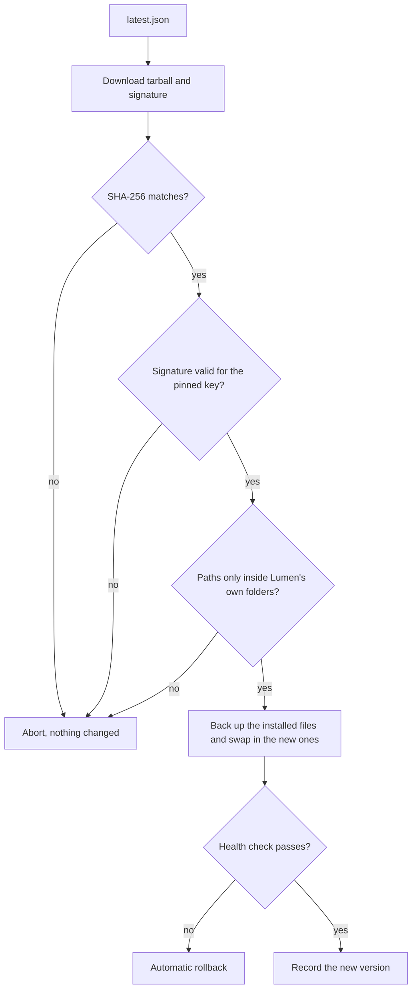

The signing key is pinned on first install, so an update signed with any other key is refused. The install record is only written after the new version has proven healthy.

### Footprint
- **On the router:** the web app (under 1 MB on disk, ~115 KB of JavaScript over the wire), a ucode plugin, a collector, and a few small scripts. Runtime data lives in `/tmp`.
- **In the browser:** no framework runtime to download beyond the app itself, and no third-party requests except the optional version checks described below.

<br>

## Security model

- **Authentication and permissions** are rpcd's own: you sign in with the router's user and password, the session lives in the tab and expires with rpcd, and every call is checked against rpcd access rules. Lumen stores no credentials.
- **Least privilege.** The plugin only exposes a fixed list of methods. Package operations accept four verbs and validated names; the installer and updater write only inside Lumen's own paths.
- **Signed releases.** SHA-256 plus an Ed25519 signature verified with OpenWrt's `usign` against a pinned key, with backup and automatic rollback.
- **No telemetry, no accounts, no cloud.** Your browser contacts GitHub to see whether a new Lumen exists and `downloads.openwrt.org` to see whether a new OpenWrt release exists. The router contacts the network only to install or update Lumen and to use its package repositories.
- **Risky changes are reversible.** Firewall and Wi-Fi edits always require explicit confirmation and roll back on their own.

<br>

## Compatibility

| Platform | Status |
|---|---|
| **OpenWrt 25.12 (apk)** | Tested, everything works (OpenWrt One and x86) |
| OpenWrt 24.10 and earlier (opkg) | Expected to work except the **Software** page, which needs `apk`; not yet verified |
| Routers without LuCI base packages | Not supported yet (see roadmap) |
| Architectures | Any: the panel and plugins are architecture-independent |

<br>

## FAQ

**Does it replace LuCI?** No. It installs next to it and never changes it, so LuCI stays available as a fallback. You can remove Lumen at any time.

**Does it change my configuration by itself?** Never. Nothing is modified unless you press a button, and risky changes roll back if you lose access.

**Where is my data stored?** Device names and types and the collector options are in `/etc/config/lumen`. Traffic history lives in RAM (`/tmp/lumen`) and can optionally be mirrored to a file of your choice.

**Why is my phone shown as "Private address"?** Recent phones use a random MAC per network, which by design carries no vendor information. You can still name it and set its type by hand.

**Why are per-device numbers lower than I expect?** Only traffic that goes *through* the router is counted, and firewall flow offloading hides established connections from the counters.

**Does it work on a router without Wi-Fi?** Yes. The Wi-Fi page explains that no radios were found and the rest works as usual.

<br>

## Project layout

```
src/
  lib/          ubus client, data layer, UCI + safe-apply, vendor lookup, live poller, stores
  components/   charts, drawers, toggles, sidebar, top bar, brand glyphs
  routes/       one file per page (Dashboard, Network Map, Traffic, Clients, Wi-Fi,
                Firewall, DHCP & DNS, Services, Software, Logs, System)
  styles/       design tokens (light and dark) and base styles
openwrt/
  rpcd/         the rpcd plugin (ucode)
  bin/          collector, package job runner, manager (install / update / uninstall)
  init/         procd init script for the collector
  config/       default /etc/config/lumen
  acl/          rpcd access rules
release/        published releases: install.sh, latest.json, signed tarballs
public/         favicon and the compressed vendor table
```

<br>

## Roadmap

- [ ] `opkg` backend for the Software page (OpenWrt 24.10 and earlier), with a compatibility test
- [ ] Independence from LuCI packages (ship Lumen's own access rules and data methods)
- [ ] Flash firmware upgrades from the panel
- [ ] Native `apk` package and feed
- [ ] More languages (English only for now)

<br>

## Credits

Vendor names come from the public IEEE registries. Brand logos are single-colour marks from
[Simple Icons](https://simpleicons.org) (CC0 artwork); they are trademarks of their owners and are used only to
identify the hardware on your own network. The panel is built with [Svelte](https://svelte.dev) and [Vite](https://vitejs.dev).
